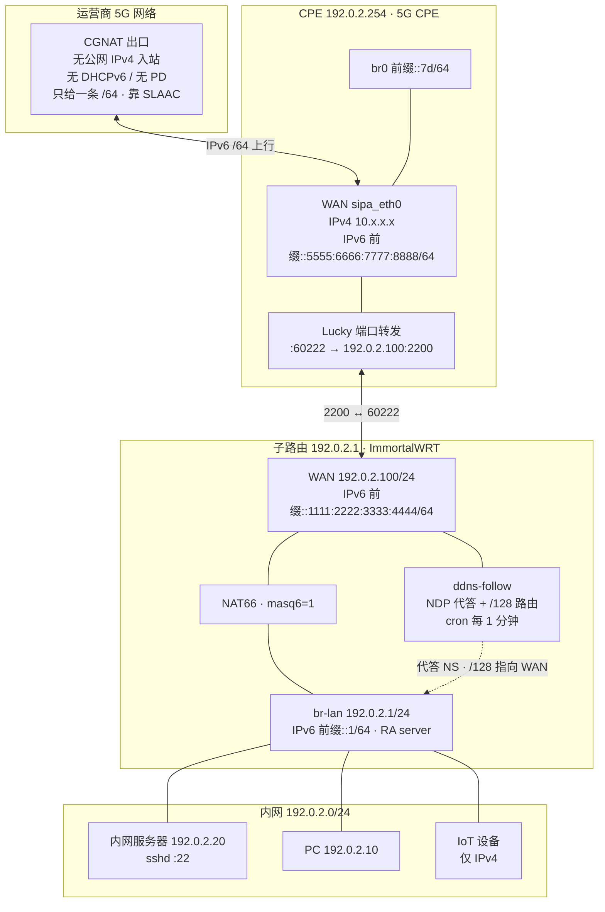

# luci-app-ddnsfollow

IPv6 NDP 代答自动跟随 —— 让内网访问自身 DDNS 域名不再超时，前缀漂移后无人值守自愈。

适用于「上游只给一条 /64、不下发 PD、且该 /64 与 LAN 同段」的场景（典型如 5G CPE 二级路由）。

## 它解决什么问题

上游 CPE 把整条 `/64` 同时用于 WAN 和 LAN。内网主机看到 DDNS 域名解析出的地址
与自己**同网段**，会直接发 NS 询问邻居，不会交给路由表；而 CPE 不在这个二层广播域里，
没人应答，结果就是 `Connection timed out`。

本方案让路由器替那个地址做 NDP 代答，并用 `/128` 明细路由把流量指向 WAN。由于运营商
前缀和 CPE 出口地址都会变，代答目标由定时任务根据 DDNS 实际解析结果自动维护。

## 网络拓扑

### 逻辑结构



### 同一张图的纯文本版

```
                  ┌────────────────────────────────┐
                  │        运营商 5G 网络          │
                  │   CGNAT · 无 PD · 仅一条 /64   │
                  └───────────────┬────────────────┘
                                  │ IPv6 SLAAC
                  ┌───────────────▼────────────────┐
                  │   CPE   192.0.2.254   5G CPE  │
                  │   WAN  前缀::aaaa:.../64       │
                  │   br0  前缀::7d/64             │
                  │   Lucky  :60222 → .105:2200    │
                  └───────────────┬────────────────┘
                                  │ 192.0.2.0/24
                  ┌───────────────▼────────────────┐
                  │   子路由  192.0.2.1          │
                  │   WAN 192.0.2.100/24         │
                  │       IPv6 前缀::bbbb:.../64   │
                  │    ├ NAT66 (masq6=1)           │
                  │    └ ddns-follow               │
                  │        NDP 代答 + /128 路由    │
                  │        cron 每 1 分钟          │
                  │   LAN br-lan 192.0.2.1/24    │
                  │       IPv6 前缀::1/64 · RA     │
                  └───────────────┬────────────────┘
                                  │ 192.0.2.0/24
          ┌───────────────────────┼───────────────────────┐
          │                       │                       │
    ┌─────▼─────┐          ┌──────▼──────┐        ┌───────▼──────┐
    │ 内网服务器  │          │     PC      │        │  IoT 设备    │
    │ .1.129:22 │          │   .1.99     │        │   仅 IPv4    │
    └───────────┘          └─────────────┘        └──────────────┘
```

> 拓扑中的 IPv6 地址每段都会漂移（运营商换前缀、CPE 换出口 MAC），
> 图中仅为示例。`ddns-follow` 负责让代答目标跟着变。

### 三条主要路径

**1. 内网出站**（访问 IPv6 互联网）

```
PC → 子路由 NAT66 → WAN → CPE → 运营商
```

LAN 设备用 `前缀::/64` 的地址，出 WAN 时由 `masq6` 换成 `前缀::bbbb:...`。

**2. 外网入站**（访问内网服务）

```
外网 → CPE Lucky :60222 → 192.0.2.100:2200 → 子路由 DNAT → Mac 192.0.2.20:22
```

**3. 内网访问自身域名**（本方案要解决的那条）

```
PC 解析 ddns.<域名> → 前缀::aaaa:...（CPE 的 WAN 地址，与 PC 同 /64）
  ↓ 判定 on-link，PC 直接发 NS 询问邻居
子路由代答（ip -6 neigh proxy）→ PC 把包交给子路由
  ↓ 按 /128 明细路由
子路由 → WAN → CPE
  ↓ Lucky 转发
CPE :60222 → 192.0.2.100:2200 → 子路由 DNAT → Mac :22
```

第 3 条绕了一圈（PC → 子路由 → CPE → 子路由 → Mac），但这是「上游无 PD、
地址与 LAN 同段」条件下唯一能走通的路径。嫌绕可以用内网 DNS 覆盖改成 IPv4 直连，
但那会影响别的设备，默认不做。

## 前置条件

| 项 | 要求 |
| --- | --- |
| 上游 | 分配 `/64`，无 PD，且与 LAN 同段 |
| 设备 | OpenWrt 21.02+ / ImmortalWRT，`luci-base`、`cron`、`dig` |
| 接口 | 一个 WAN（IPv6 上游）、一个 LAN |
| 权限 | root |

## 安装

```sh
# 方式一：直接拷贝
scp -r . root@192.0.2.1:/tmp/luci-app-ddnsfollow
ssh root@192.0.2.1 "sh /tmp/luci-app-ddnsfollow/install.sh"

# 方式二：打成 ipk（需 OpenWrt SDK）
# 把本目录放进 package/ 下，make package/luci-app-ddnsfollow/compile
```

安装后进入 LuCI：**服务 → DDNS IPv6 跟随**。

## 配置项

`/etc/config/ddnsfollow`

| 键 | 默认 | 说明 |
| --- | --- | --- |
| `enabled` | `1` | 总开关，关闭后不修改任何内核状态 |
| `domain` | `ddns.example.com` | 要跟随 AAAA 的域名 |
| `interval` | `2` | 执行间隔（分钟），1–60 |
| `timeout` | `3` | 单次 DNS 查询超时（秒） |
| `strict_prefix` | `1` | DDNS 前缀与 LAN 前缀不一致时跳过本轮 |
| `keep_stale` | `1` | 解析失败时保留现有代答 |
| `clean_others` | `1` | 只保留当前目标，清掉其他代答条目 |
| `manage_lan_addr` | `0` | 允许脚本给 LAN 补 `前缀::1/64` |
| `lan_iface` | `br-lan` | 代答挂载接口 |
| `wan_iface` | `wan` | `/128` 路由出接口 |
| `upstream_gw` | 空 | 上游网关，留空自动取默认路由 `via` |
| `log_max_lines` | `500` | 日志上限，超出轮转 |

### 两个关键策略开关

- `strict_prefix=1`：DDNS 有 5 分钟同步延迟，前缀没追上时**先不动**，避免把代答指到不存在的地址。
- `keep_stale=1`：公共 DNS 全挂时**保持现状**。关掉会导致内网瞬间断流。

这两个默认都开，宁可「暂时不动作」也不要「立刻改错」。

## 验证

```sh
/usr/bin/ddns-follow-status
# 期望 resolved 与 proxy 相等，route_dev=wan

ip -6 neigh show proxy dev br-lan
ip -6 route get $(dig +short AAAA <域名> @223.5.5.5)
```

内网跑 `ssh -p <端口> <用户>@<域名>`，走到认证阶段（`Permission denied` 属正常）即链路通。

## 收敛时间

| 事件 | 上界 |
| --- | --- |
| 运营商换前缀 | ≤ 2 分钟（hotplug 立即 + cron 兜底） |
| CPE 换出口地址 | ≤ 7 分钟（DDNS 5 分钟 + cron 2 分钟） |
| 路由器重启 | ≤ 90 秒 |

## 卸载

```sh
sh uninstall.sh          # 移除程序与 cron 行，保留配置
rm -f /etc/config/ddnsfollow
```

## 已知限制

- **无法让下游拿到 PD**：上游链路没有 DHCPv6 服务器（实测 IA_NA / IA_PD 均无响应），
  这是链路能力问题，换客户端无解。
- **无法端到端可达**：上游 CGNAT，对外访问需另配端口转发或隧道。
- 依赖 `ip -6 neigh proxy`，部分内核裁剪过该功能的固件不支持。

## 文件布局

```
src/usr/bin/ddns-follow                                  主脚本
src/usr/bin/ddns-follow-status                           状态采集（key=value）
src/etc/config/ddnsfollow                                UCI 配置
src/etc/hotplug.d/iface/95-lan6-prefix                   前缀漂移自愈
src/etc/uci-defaults/99-ddnsfollow                       首装初始化
src/usr/share/luci/menu.d/luci-app-ddnsfollow.json       菜单
src/usr/share/rpcd/acl.d/luci-app-ddnsfollow.json        ACL
src/www/luci-static/resources/view/ddnsfollow/overview.js 页面
docs/DESIGN.md                                           产品化设计文档
```

## License

MIT
